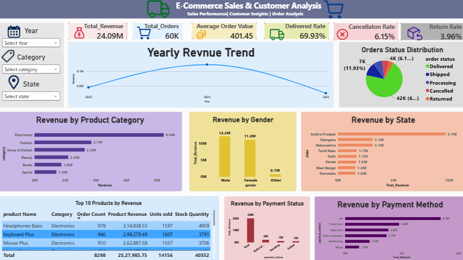

# E-Commerce Sales & Customer Analytics

An end-to-end portfolio project using **MySQL** and **Power BI** to analyze e-commerce sales, orders, customers, products, payments, deliveries, and returns.

## Project objectives
- Analyze total revenue, order volume, and average order value (AOV).
- Understand delivered, cancelled, and returned order patterns.
- Compare revenue by state, city, product category, customer gender, sales channel, and payment method.
- Explore discount-level sales/AOV, product performance, stock risk, delivery duration, and return reasons.
- Analyze payment status and customer repeat purchasing.

## Tools
- MySQL / MySQL Workbench
- Power BI Desktop
- GitHub

## Data model
The SQL script creates six tables: `customers`, `products`, `orders`, `payments`, `order_items`, and `returns`.

**Grain matters:** `orders` is one row per order, while `order_items` may contain multiple rows per order. Use `orders.total_payable` for order-level revenue and `order_items.line_total` for product/category revenue. Avoid summing order-level revenue after joining to multiple order-item rows.

## Regional Analysis
**Reported project finding:** This analysis compares order volume, revenue, and product category performance across Andhra Pradesh and Telangana using SQL. Exact order counts and revenue figures will be added after validating the final query outputs.

For the AP/Telangana category query, use `COUNT(DISTINCT o.order_id)` if the metric is unique orders; a direct `COUNT(o.order_id)` after joining `order_items` can count an order multiple times.

## SQL analysis included
- Total and monthly sales; growth calculations
- Delivered, cancelled, and returned rates
- Revenue by category, city, state, sales channel, and gender
- Customer segments, repeat purchasing, and customers who never ordered
- Delivery time and monthly deliveries
- Top products and low-stock products
- Payment status/success and payment method analysis
- Return reasons and discount-level sales/AOV

## Power BI dashboard
The report includes KPI cards for Total Revenue, Total Orders, AOV, Delivered Rate, Cancellation Rate, and Return Rate; Year, Category, and State slicers; yearly revenue trend; order-status distribution; revenue by category, gender, state, payment status, and payment method; and a Top 10 Products table.

Add a clean exported dashboard image named `dashboard_preview.png`, then uncomment:
< -->

## Key Business Metrics and Regional Analysis

### Overall Business Metrics

| Metric | Reported Value |
|---|---|
| Total Orders | 60,000 |
| Total Order Revenue | Approximately 24.09M |
| Average Order Value (AOV) | Approximately 401.45 |
| Delivered Orders | 41,960 (69.93%) |
| Cancelled Orders | 3,689 (6.15%) |
| Returned Orders | 2,374 (3.96%) |
| Delivered Revenue | Approximately 16.86M (70.01%) |
| Payment Success Rate | 82.48% (denominator requires validation) |

Andhra Pradesh — Category Performance

Category| Orders Placed (Reported)| Total Sales
Electronics| 11,767| 3,431,342.63
Fashion| 9,057| 1,456,925.26
Home & Kitchen| 8,035| 1,306,459.33
Beauty| 5,444| 885,545.79
Books| 4,524| 719,346.70
Sports| 3,599| 580,081.95

Telangana — Category Performance

Category| Orders Placed (Reported)| Total Sales
Electronics| 3,808| 1,087,314.18
Fashion| 2,968| 469,954.57
Home & Kitchen| 2,685| 427,613.33
Beauty| 1,822| 287,600.90
Books| 1,441| 233,842.10
Sports| 1,152| 186,181.08

Additional Regional Finding

Metric| Reported Value
Hyderabad Electronics Revenue| 618,000 (requires validation against the final SQL output)

Validation note: Regional order counts are copied from the current SQL result screenshots. Verify them using "COUNT(DISTINCT o.order_id)" if the query joins orders to multiple order-item rows. Confirm the sales calculation and payment success rate denominator before publishing.
Discount AOV values previously reported were 443.12 at 0%, 426.85 at 5%, 405.09 at 10%, 385.31 at 15%, and 365.43 at 20%. This is an association, not proof of causation.

The inventory analysis previously flagged Yoga Mat Classic (stock 0; 76 historical delivered units sold) and Headphones Pro (stock 5; 81 historical delivered units sold). Treat these as possible replenishment signals, not demand forecasts.

## SQL validation notes
Before publishing, check:
1. Do not sum `orders.total_payable` after a one-to-many join to `order_items`.
2. Use `COUNT(DISTINCT order_id)` for unique order counts after joining order items.
3. Avoid reporting growth from a zero previous-month value as a meaningful percentage.
4. Remove ungrouped `order_status` from the Top 10 product query, and sort by revenue if the visual is titled Top 10 by Revenue.
5. Prevent duplicated order revenue when joining to multiple payment records.
6. Define whether delivery time is item-level or order-level.
7. Define repeat purchase rate denominator clearly.

## Recommendations
- Investigate cancellations and returns by channel, payment method, and shipping type.
- Compare category mix across Andhra Pradesh, Telangana, and other states using final outputs.
- Review low-stock items alongside recent sales and supplier lead time.
- Evaluate discount effectiveness using margin and conversion as well as AOV.
- Monitor payment failures and repeat purchasing with clear metric definitions.

## Repository structure
```text
ecommerce-sales-customer-analytics/
├── README.md
├── data/
│   ├── customers.csv
│   ├── orders.csv
│   ├── order_items.csv
│   ├── products.csv
│   ├── payments.csv
│   └── returns.csv
├── sql/
│   └── ecommerce_analysis.sql
├── dashboard/
│   └── dashboard.pbix
├── notebooks/
│   └── dataquality.ipynb
└── outputs/
    └── output.png
```

## Data privacy
Do not commit passwords, credentials, or private customer information. Only publish data you are authorized to share. Check the PBIX file for embedded sensitive data before making the repository public.
